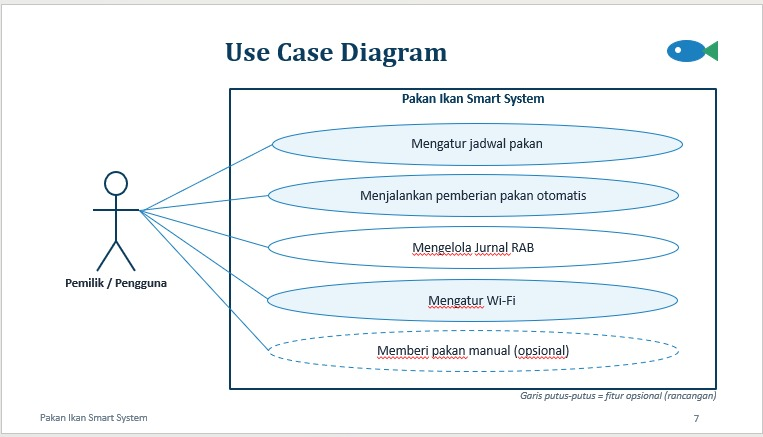
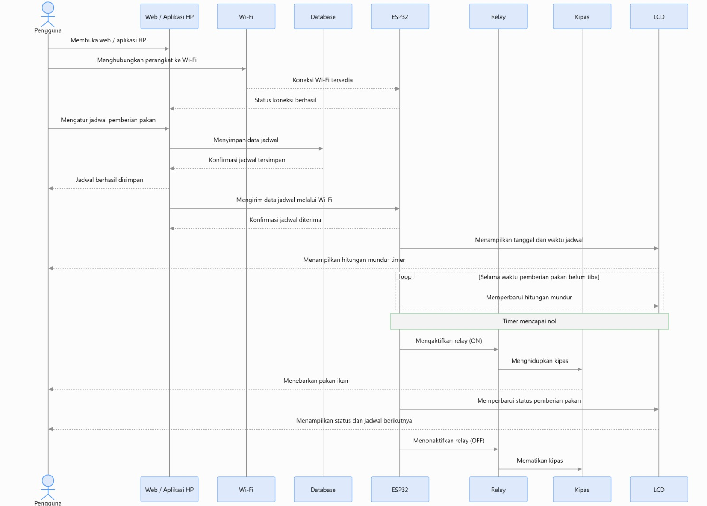
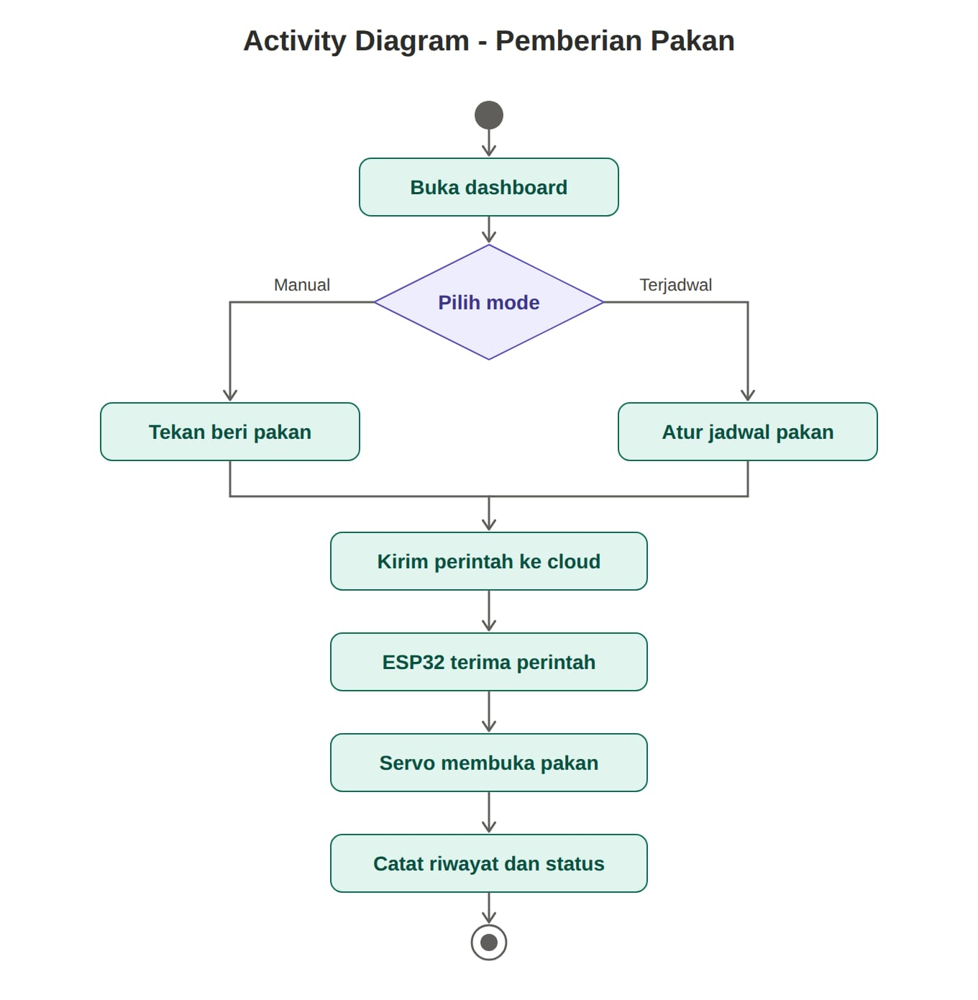
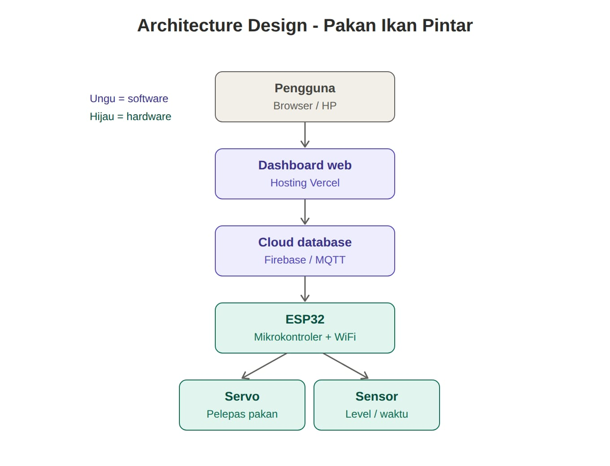

# 🐟 Sistem Pakan Ikan Pintar

## Tugas Mata Kuliah: Analisis & Pengujian Sistem

### Anggota Kelompok

1. Dewi Santika — 23EO10020
2. Ulfiatul Ulya — 23EO10006
3. Uswatun Hasanah — 23EO10028
4. Hasna Kamalia Hakim — 23EO10037
5. Nabilia Afrilia — 23EO10009

---

## A. Deskripsi Proyek

Repositori ini berisi dokumentasi, diagram perancangan, dan kode program proyek **Sistem Pakan Ikan Pintar** yang dikembangkan untuk memenuhi tugas mata kuliah Analisis & Pengujian Sistem.

Proyek ini bertujuan untuk menganalisis kebutuhan, merancang arsitektur, mengimplementasikan, dan menguji sistem berbasis mikrokontroler ESP32.

Sistem menggunakan ESP32 sebagai mikrokontroler utama yang terhubung dengan LCD 16x2 I2C untuk menampilkan informasi tanggal, bulan, tahun, dan timer. ESP32 juga mengirimkan sinyal kontrol ON/OFF untuk mengendalikan kipas sesuai dengan logika program yang diterapkan.

### Tujuan Proyek

- Menganalisis kebutuhan sistem.
- Merancang arsitektur perangkat keras dan perangkat lunak.
- Mengimplementasikan sistem berbasis ESP32.
- Menguji fungsi setiap komponen dan integrasi sistem.
- Mendokumentasikan hasil pengembangan dan pengujian sistem.

---

## B. Desain Proyek

### 1. Use Case Diagram

Diagram ini menggambarkan interaksi aktor dengan sistem dan fungsi yang tersedia.



### 2. Sequence Diagram

Diagram ini menggambarkan urutan interaksi antarbagian sistem dalam menjalankan proses.



### 3. Activity Diagram

Diagram ini menggambarkan alur aktivitas dan proses kerja sistem.



---

## C. Arsitektur Proyek

### 1. Komponen Sistem

- **ESP32:** Mikrokontroler utama untuk memproses program dan mengendalikan sistem.
- **LCD 16x2 I2C:** Menampilkan informasi tanggal, waktu, dan timer.
- **Kipas:** Perangkat output yang dikendalikan melalui sinyal ON/OFF.
- **Power Supply:** Menyediakan daya sesuai kebutuhan tegangan komponen.

### 2. Diagram Arsitektur Sistem



### 3. Alur Kerja Sistem

1. Power supply menyediakan daya untuk komponen sistem.
2. ESP32 menjalankan program sesuai logika yang telah dibuat.
3. LCD 16x2 I2C menampilkan informasi tanggal, waktu, dan timer.
4. ESP32 mengirimkan sinyal kontrol untuk menghidupkan atau mematikan kipas.
5. Sistem menjalankan fungsi sesuai dengan program yang diimplementasikan.

---

## D. Analisis dan Pengujian Sistem

Pengujian dilakukan untuk memastikan setiap komponen dan fungsi sistem berjalan sesuai dengan kebutuhan yang ditentukan.

Aspek pengujian meliputi:

1. **Pengujian ESP32:** Memastikan mikrokontroler menjalankan program dengan baik.
2. **Pengujian LCD:** Memastikan informasi ditampilkan dengan benar.
3. **Pengujian Timer:** Memastikan timer berjalan sesuai logika program.
4. **Pengujian Kipas:** Memastikan kendali ON/OFF berfungsi sesuai perintah.
5. **Pengujian Catu Daya:** Memastikan kebutuhan daya komponen terpenuhi.
6. **Pengujian Integrasi:** Memastikan seluruh komponen dapat bekerja bersama.

Hasil pengujian dapat ditambahkan setelah pengujian sistem dilaksanakan.

---

## E. Teknologi yang Digunakan

| Komponen | Teknologi |
|---|---|
| AI untuk membantu pengembangan | Claude AI |
| Lingkungan pengembangan | Visual Studio Code |
| Database | Supabase |
| Konektivitas | Wi-Fi |
| Mikrokontroler | ESP32 |
| Antarmuka tampilan | LCD 16x2 I2C |

*Catatan: Daftar teknologi ini perlu disesuaikan dengan teknologi yang benar-benar digunakan dalam implementasi proyek.*

---

## F. Struktur Repositori

```text
pakan-ikan-app/
├── README.md
└── src/
    └── images/
        ├── activity-diagram.jpeg
        ├── arsitektur-sistem.jpeg
        ├── sequence-diagram.jpeg
        └── use-case-diagram.jpeg
```

Struktur di atas menunjukkan lokasi file README dan gambar diagram dalam proyek.

---

## G. Repository GitHub

Kode program dan dokumentasi proyek tersedia di:

[**Pakan Ikan Smart System — GitHub**](https://github.com/santi111a/pakan-ikan-smart-system)

---

## H. Penutup

Proyek Sistem Pakan Ikan Pintar ini menjadi sarana pembelajaran dalam analisis kebutuhan, perancangan arsitektur, implementasi, dan pengujian sistem berbasis mikrokontroler.

Dokumentasi ini disusun untuk memenuhi tugas mata kuliah Analisis & Pengujian Sistem.